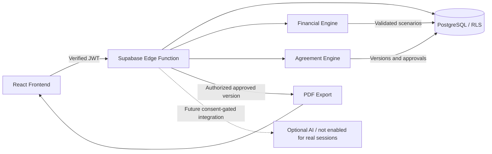

<div align="center">
  
  <h1>FirstSharedMoney</h1>
  <p><strong>Two people. Different money habits. One shared plan.</strong></p>
  <p>A clearer first conversation about sharing money, responsibilities, and a future.</p>
  <p>
    <a href="https://firstsharedmoney.vercel.app/">Explore the website</a> &middot;
    <a href="https://firstsharedmoney.vercel.app/sessions/demo">Explore Preview</a> &middot;
    <a href="https://github.com/anuarmariyam/FirstSharedMoney">GitHub Repository</a>
  </p>
</div>


[](https://firstsharedmoney.vercel.app/)

FirstSharedMoney is a web-based financial planning platform that helps couples beginning their shared financial life understand each other's financial expectations, explore ways to split expenses, prepare for unexpected changes, and create a mutually approved financial agreement.

Designed primarily for US couples aged 25-45 who are planning shared finances for the first time, FSM turns separate perspectives into practical decisions both people can revisit.

## Live Website

**[https://firstsharedmoney.vercel.app](https://firstsharedmoney.vercel.app/)**

Explore FirstSharedMoney online and discover how two partners can turn individual financial expectations into one shared plan. No email registration is required.

| Experience | What to expect |
| --- | --- |
| **Preview** | Explore a sample plan without signing in. Budget examples and comparison topics are fixed; they are not calculated from your questionnaire. Editing example inputs hides the primary example result. Preview answers and drafts reset on refresh and cannot record real approvals or export an approved PDF. |
| **Your shared session** | Start a plan, invite your partner, and answer separately using independent anonymous browser identities. Submitted answers persist; authorized comparisons, financial scenarios, agreement versions, confirmations, and PDF export use the real backend. |

Use fictional financial details when evaluating the public release. For two partners, use separate browser profiles or devices. Keep your original browser access: clearing its storage removes automatic access, and anonymous identity recovery is not available.

## The Problem

Couples often begin sharing rent, bills, and financial responsibilities before discussing income differences, savings expectations, personal debts, unexpected costs, or financial boundaries.

An expense tracker can show what was spent. It does not necessarily help two people decide how to share costs, understand different expectations, or confirm the same plan before those decisions become a source of friction.

## Our Solution

**A guided two-person decision workflow, ending in a First Money Agreement.**

1. **Create a shared session** with your own browser identity.
2. **Invite a partner** through a private, one-use invitation.
3. **Answer separately** to describe your finances and preferences.
4. **Compare perspectives** when both partners permit comparison.
5. **Explore the budget** through alternative splits and stress scenarios.
6. **Build an agreement** from a validated, saved financial scenario.
7. **Approve independently** so both confirmations refer to the same version and content.
8. **Download the agreement** once the current version has both confirmations and passes the server's access checks.

## Key Features

| Feature | What it does |
| --- | --- |
| Independent partner identities | Separate anonymous access for Partner A and Partner B; one identity cannot occupy both places. |
| Private questionnaire | Fifteen questions covering income, obligations, shared costs, savings, purchases, emergencies, transparency, and budget reviews. |
| Two sharing choices | Separate, revocable permissions for preference comparison and shared financial inputs. Neither permission authorizes external AI processing. |
| Conflict Detection Engine | Classifies aligned preferences, different expectations, and unresolved decisions without psychological compatibility scores. |
| Three expense splits | Equal, income-based Proportional, and Custom percentage allocation, including zero-income and affordability states. |
| Exact-cent calculations | Integer cents and BigInt intermediates preserve allocation totals without losing cents to rounding. Live scenarios are calculated and validated server-side before saving. |
| Five stress scenarios | Higher rent, reduced income, an unexpected shared expense, temporary income loss, and a changed savings target. Reserve use is accounted for separately. |
| Financial visualization | Expense breakdowns, contribution bars, income burden, remaining balances, and before/after scenario comparisons. |
| Smart Insights | Deterministic explanations of validated results, financial warnings, and neutral questions to discuss together. |
| Immutable agreement versions | Editing terms creates a new version; earlier confirmations do not transfer. |
| Independent approvals | Both partners explicitly confirm the same version and content hash using their own identities. |
| Authorized PDF export | A server-generated document with agreed amounts, rules, version details, and confirmation timestamps; access is rechecked before delivery. |

**Financial calculations are deterministic.** Neither an LLM nor a compatibility score decides how much either partner pays or whether an agreement is approved.

## Screenshots / Product Preview

Explore the actual interface through the links below. Repository-hosted product screenshots have not been published yet; these links open the working application rather than mockups.

| Screen | Explore |
| --- | --- |
| Landing Page | [Product introduction and how it works](https://firstsharedmoney.vercel.app/) |
| Create Shared Space | [Start your own shared plan](https://firstsharedmoney.vercel.app/create) |
| Questionnaire | [Explore the fifteen-question experience](https://firstsharedmoney.vercel.app/sessions/demo/questionnaire) |
| Financial Simulator | [Compare sample allocation models](https://firstsharedmoney.vercel.app/sessions/demo/simulator) |
| Expense Breakdown | [View the example budget, contributions, and Insights](https://firstsharedmoney.vercel.app/sessions/demo/simulator) |
| Agreement Builder | [Explore the example rules](https://firstsharedmoney.vercel.app/sessions/demo/agreement) |
| Agreement Document / PDF | [View the unapproved document layout](https://firstsharedmoney.vercel.app/sessions/demo/agreement/preview). An approved PDF requires two real confirmations in a shared session. |

The interface supports desktop, tablet, and mobile, with a light cream/lavender palette and keyboard-accessible controls.

## Technology Stack

| Area | Implementation |
| --- | --- |
| Frontend | React, TypeScript, Vite, React Router |
| Styling | Tailwind CSS with custom CSS |
| Authentication | Supabase Anonymous Auth |
| Backend | Supabase Edge Functions and PostgreSQL RPCs |
| Database access | Supabase PostgreSQL, Row Level Security, and explicit access checks |
| Validation and calculations | Typed contracts, runtime validators, deterministic TypeScript engines |
| PDF | Server-side `pdf-lib` |
| Deployment | Vercel-hosted frontend; Supabase-hosted backend |
| Testing | Node.js unit tests, Playwright UI tests, and real security/integration tests in an authorized test project |
| Linting | Oxlint via `npm run lint` |

## Architecture



The server is authoritative for saved financial scenarios, agreement state, and PDF eligibility. The frontend renders typed results and keeps the sample Preview separate from real sessions.

Implementation references: [Architecture](docs/ARCHITECTURE.md), [Database Schema](docs/DATABASE_SCHEMA.md), and [User Flow](docs/USER_FLOW.md).

## Security & Privacy

- **Separate identities:** each partner has independent anonymous access. Invitations are cryptographically random, one-use, expiring, and stored as hashes.
- **Private answers:** raw questionnaire records and private notes are owner-only. Budget consent separately permits the structured income and obligation inputs needed for shared planning.
- **Consent-gated results:** comparison and budget permissions are independent. Withdrawal and revision changes are checked server-side before shared results can be retrieved.
- **Layered access checks:** JWT verification, membership checks, PostgreSQL permissions, guarded RPCs, and RLS enforce access beyond the interface.
- **Server-authoritative finances:** client-supplied calculated totals are not accepted as authoritative saved results.
- **Version-bound confirmations:** approvals bind an authenticated partner to a specific version and content hash. New content requires new confirmations.
- **Restricted PDF delivery:** only authorized partners can export the current eligible, twice-approved agreement. No public document URL substitutes for access checks.
- **Server-only secrets:** privileged credentials and the experimental Groq key do not belong in the browser or repository.

These are implemented controls backed by testing, not a claim of absolute security, regulatory certification, or completed commercial operations readiness.

## Smart Insights & Qwen

**Currently available:** deterministic Smart Insights based on validated financial calculations. Generate Insights explains the displayed plan, highlights allocations and potential shortfalls, and suggests discussion questions. It works without an external AI service.

**Experimental:** Qwen through GroqCloud was tested separately with fictional data. The narrow PoC validates structured evidence IDs; it does not generate authoritative financial amounts, change agreements, or analyze real shared sessions.

External AI for real financial data remains disabled. Enabling it requires separate explicit consent, server-side consent enforcement, payload review, durable rate limiting, and an approved deployment. Existing comparison/budget consents do not authorize sharing with an AI provider.

See the [Qwen PoC notes](docs/QWEN_INSIGHTS.md) for the isolated implementation and its limitations.

## Getting Started

### Requirements

- **Node.js 24.x**; the verified local toolchain uses Node.js 24.11.1.
- **npm 11.6.2**, the verified clean-install version used for this release.
- Git; Microsoft Edge for the current Playwright browser configuration.

### Install

```bash
git clone https://github.com/anuarmariyam/FirstSharedMoney.git
cd FirstSharedMoney
npm ci
```

Use the integrated `main` branch. On Windows PowerShell, use `npm.cmd` in place of `npm` if script execution policy blocks npm's PowerShell wrapper.

### Configure public backend settings

Copy [.env.example](.env.example) to `.env.local` and fill in the public settings for your configured Supabase project:

```dotenv
VITE_SUPABASE_URL=
VITE_SUPABASE_PUBLISHABLE_KEY=
```

Leave these blank to explore Preview without a backend. Real session creation needs Anonymous Auth and the existing database/Edge setup described in [Supabase Setup](docs/SUPABASE_SETUP.md). The frontend origin must be explicitly allowed by the backend.

Never place a database password, privileged Supabase key, or Groq key in a `VITE_` variable. Local environment files are ignored by Git. Review backend setup before any cloud change; do not apply migrations to a shared project without authorization.

### Run locally

```bash
npm run dev -- --host 127.0.0.1 --port 5173 --strictPort
```

Open [http://127.0.0.1:5173](http://127.0.0.1:5173/). For a real two-person flow, use separate browser profiles or devices and share only the generated partner invitation.

### Build

```bash
npm run build
```

Vite writes the frontend to `dist`. The Vercel configuration includes an SPA fallback so direct React Router links can load after refresh.

## Testing

These local commands do not require cloud database credentials:

```bash
npm run typecheck
npm run lint
npm run build
npm run test:backend
npm run test:ui
```

The separate AI adapter/fallback suite is also offline:

```bash
node --test tests/backend/financial-insights.test.ts
```

Unit tests check contracts, exact financial allocation, edge cases, agreement rules, and PDF behavior. Playwright covers desktop/tablet/mobile navigation, input validation, preview boundaries, accessibility interactions, and overflow. Its offline UI configuration removes Supabase settings and uses an isolated local server.

**Cloud security and live integration tests are separate.** They require an explicitly authorized test project, guarded local configuration, verified database TLS, and permission to create and clean up test-owned records. Do not run them against customer or shared production data. They exercise real independent A/B/C identities, private access, consents, persistence, approvals, and PDF download; offline mocks do not establish that those controls work in the cloud.

See [verification and setup guidance](docs/SUPABASE_SETUP.md) before requesting a cloud test run. Cloud mutation commands are intentionally not included in this quick start.

## Current Status

| Capability | Status |
| --- | --- |
| Core two-person financial planning workflow | Implemented and integration-tested |
| Independent A/B confirmations and authorized PDF export | Implemented and integration-tested |
| Public frontend | Deployed on Vercel, connected to the verified Supabase test backend |
| Smart Insights | Available in deterministic mode |
| Qwen / GroqCloud | Experimental, fictional-data PoC; not connected to real sessions |
| Bank connections, payments, and money transfers | Not implemented |

The public release is available for evaluation with fictional data. Banking integrations, commercial billing, and ongoing operational/privacy readiness are not implied by the hackathon deployment.

## Team

**Team ForExample**

- Mariyam Anuar
- Dilmira Dauletova
- Saida Yerbol

**Project:** Zimran Business Cup 2.0 - MONEY Track.

## Disclaimer

FirstSharedMoney is a financial planning and communication tool. It does not provide banking services, transfer funds, or offer professional financial or legal advice.
