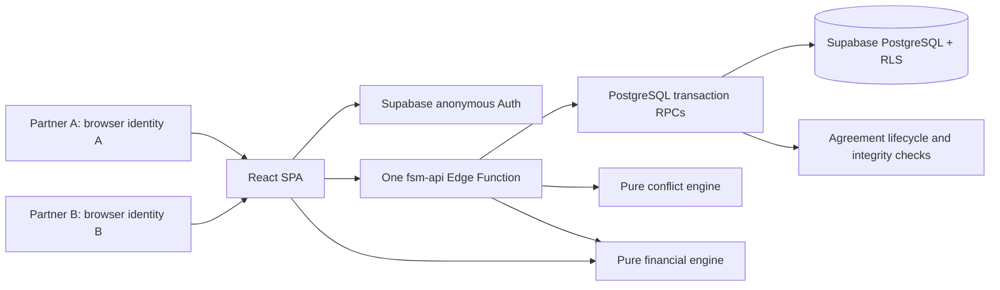
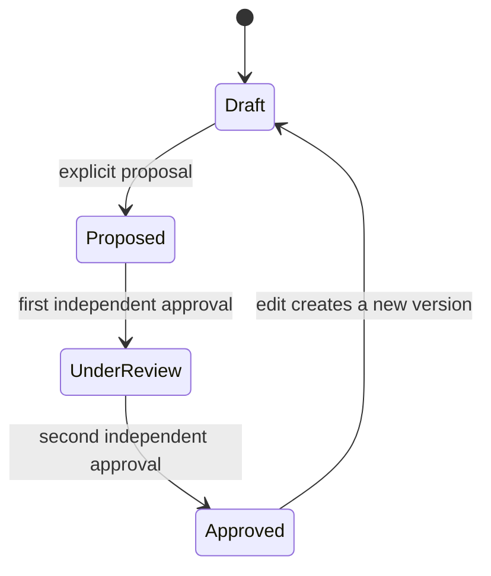

# FirstSharedMoney: System Architecture

Status: Phase 2 architecture accepted on 2026-11-14. Phase 4A's session foundation
is deployed and verified in the approved test project; see PHASE4A_VERIFICATION.md.
Phase 4B questionnaire persistence/privacy is also verified; see PHASE4B_VERIFICATION.md.
Phase 5 financial/comparison and Phase 6 agreement/PDF are now verified in the
same approved test project: 11 migrations, fsm-api v4 and 143 passing checks.
See PHASE5.md and PHASE6.md for runtime evidence. The sections below retain the
approved Phase 2 design; features outside the delivered phases remain planned.
Phases 1-6 are complete in the test-project scope, and backend commit 1aaeb3a
is published. Production website deployment/public submission remain pending;
AI/Qwen has no connection to the main application's data or approval workflow.

## 1. Existing project and boundaries

The working root is `D:\FirstSharedMoney`. Phase 1 initialized the Vite React
starter and Git/lockfile. Current owner development uses `backend/fsm-core`; main
still preserves Phase 3. React
19.3.1, TypeScript 7.0.2, and Vite 8.3.8 are installed locally. Node.js 24.11.1
and npm 11.6.2 run the tooling. The npm cache is `D:\npm-cache`.

The application uses ESM, Vite's React plugin, TypeScript project references,
`noEmit`, and bundler module resolution. Phase 2 enables `strict` in both the
application and tooling TypeScript configurations. The current UI, guarded
session services and test-mode Vite configuration extend that baseline. Runtime
dependencies now include Supabase and server-only pdf-lib; there is no LLM SDK.

The design below is the approved implementation reference. Delivered runtime
behavior is evidenced by PHASE4A_VERIFICATION.md, PHASE4B_VERIFICATION.md,
PHASE5.md and PHASE6.md, not by these design declarations alone. Database
details are in [DATABASE_SCHEMA.md](DATABASE_SCHEMA.md), the journey is in
[USER_FLOW.md](USER_FLOW.md), and delivery priorities are in
[MVP_SCOPE.md](MVP_SCOPE.md).

## 2. Runtime architecture



Use one SPA and one routed Edge Function. Avoid a separate Node server, custom
identity provider, message queue, or microservices. PostgreSQL owns persistence,
membership enforcement, version serialization, and approvals. Edge handlers
verify identities, validate requests, run calculations, and return explicit DTOs.

The financial module is portable TypeScript with no browser, React, Supabase,
clock, or network imports. Later, the Edge bundle and frontend import this same
source; verify that bundling arrangement during integration. The server always
recomputes persisted scenarios. Browser calculations are previews.

### Proposed source layout

Phase 2 created `src/types/domain.ts`, `src/types/api.ts`, and
`src/types/engines.ts`. Phase 3 adds the first real frontend modules under the
following layout; do not create unused placeholder folders:

```text
src/
  app/                         routing, providers, application shell
  components/                  reusable accessible UI primitives
  pages/                       route composition, no financial arithmetic
  features/
    questionnaire/             private form, catalog rendering, owner autosave
    comparison/                consent-aware differences presentation
    simulator/                 portable domain engine and scenario interaction
    agreement/                 agreement policy, builder, review, document view
  services/                    typed API transport and Supabase Auth adapter
  lib/                         parsing, money formatting, validated identifiers
  hooks/                       session and visibility-aware polling hooks
  types/                       domain models, API DTOs, engine ports
supabase/                      session migrations and Edge Function foundation
docs/                          implementation design and scope
```

Features depend on domain contracts and service interfaces. UI components do
not call database tables or decide access. Do not create empty scaffolding,
barrel files, or repository abstractions before they have consumers.

Use React state and small feature hooks initially. Poll shared state every five
seconds while a relevant page is visible; pause when hidden and refetch on focus.
Realtime and a global state library are unnecessary for the first release.
Persist drafts on the server; keep financial response caches in memory and clear
them on identity changes. Reload restores the same browser's Auth session and
then fetches authoritative state.

## 3. Authentication and authorization

### Alternatives

| Approach | Benefits | Cost and limitations | Decision |
| --- | --- | --- | --- |
| Supabase anonymous Auth + per-user membership + one-time invite | Separate signed identities without an email/password form; fits `auth.uid()` and RLS | Browser-session loss cannot be recovered automatically; anonymous creation needs abuse controls | Recommended |
| Separate long-lived custom bearer capability for each role | No Auth user records | Requires custom token verification, rotation, revocation, storage, and database identity propagation | Avoid for a 24-hour MVP |
| Email magic links or OTP | Account recovery and cross-device continuity | Requires email entry and delivery; adds friction to the main journey | Optional later upgrade |
| One shared couple password or secret link | Minimal UI | Cannot distinguish approvals or protect one partner's answers from the other | Rejected |

Supabase anonymous users have distinct user IDs and use the `authenticated`
database role. They are different from unauthenticated requests using a project
API key. Clearing their browser session loses access unless an account method
has been linked. See [Anonymous Sign-Ins](https://supabase.com/docs/guides/auth/auth-anonymous).

### Recommended identity flow

1. Each browser establishes its own anonymous Auth session. A's session creates
   the couple and slot A. Never send A's JWT or refresh token in an invitation.
2. The database generates a 32-byte cryptographically random invitation token
   using `pgcrypto` and returns its 43-character base64url encoding once. Store
   only its SHA-256 digest. This token grants eligibility to claim slot B only.
3. The link is `/join#token=<token>`. Read the fragment into memory and immediately
   remove it with `history.replaceState`. Do not put it in a query parameter,
   analytics event, localStorage, error report, or ordinary application log.
4. B signs in anonymously in a separate browser profile/device and redeems the
   token through an authenticated command. One database transaction consumes it
   and inserts slot B. Enforce different Auth user IDs for A and B.
5. Later session URLs contain only a random session UUID as a locator. They are
   not access links: the independent Auth identity and active membership are
   required on every request. No partner credential is shared between roles.

The invitation expires after 24 hours or at session expiry, whichever is earlier.
A can rotate it before B joins, revoking the old token atomically. Membership
expires after 30 days for standard sessions and two hours for demo sessions.
Members can revoke their own membership immediately. JWT lifetime and refresh
are managed by Supabase; database expiry/revocation checks still apply while a
JWT remains cryptographically valid. Expired or revoked seats are not recycled.

The same Auth identity cannot occupy both seats. Opening an invite while already
signed in as A must display an explanation and instructions for a separate
profile/private browser window. Never automatically replace A's identity.

### Data access rules

All application tables enable RLS. `anon` has no table access. `authenticated`
gets only the SELECT grants and policies described in DATABASE_SCHEMA.md, with
no direct INSERT/UPDATE/DELETE grants. This also blocks bypasses through the
PostgREST Data API. The Edge API is not the only security boundary.

User-facing transaction RPCs use `auth.uid()` and revalidate active membership,
expiry, state, request shape, and expected revisions inside PostgreSQL. Carefully
scoped `SECURITY DEFINER` functions use an empty `search_path`, fully qualified
relations, and explicit execution grants. A grant alone does not establish
ownership. See [Database functions](https://supabase.com/docs/guides/database/functions)
and [RLS](https://supabase.com/docs/guides/database/postgres/row-level-security).

Raw answers are owner-readable only, even after submission. There is no endpoint
to read the other partner's answers. Optional free text is never included in
shared comparisons or scenarios. Shared partner DTOs omit Auth user IDs,
credentials, revision internals, and answer contents.

Two separate, explicit, unchecked-by-default consents are recorded per partner:

- **Comparison:** allow derived aligned/different/unresolved summaries from the
  designated comparison questions. Do not return raw choices, amounts, or text.
- **Budget:** allow the current submitted monthly net income and aggregate
  personal-obligation total to appear in shared simulator input snapshots.

Both partners must grant the applicable consent. A statement about transparency
inside the questionnaire is a preference, not authorization. Reopening a
questionnaire clears both consents. Revocation blocks subsequent relevant reads
and calculations; it cannot erase information already displayed or downloaded.
Already shared agreement terms remain in version history until session deletion.

For cross-partner calculations only, Edge uses a server-only secret to invoke
narrow internal RPCs that fetch consent-filtered inputs or store a recomputed
scenario. These RPCs require explicit actor IDs derived from a verified JWT,
recheck membership and consent, and are executable only by the server role.
Never expose their raw input DTOs or grant these RPCs to `authenticated`.
Every public mutation RPC remains safe if called directly without the Edge API.

Frontend configuration may later include only `VITE_SUPABASE_URL` and
`VITE_SUPABASE_PUBLISHABLE_KEY`. A server secret such as
`FSM_SUPABASE_SECRET_KEY`, including legacy `service_role` equivalents, belongs
only in Edge secrets and must never use a `VITE_` prefix. Elevated keys bypass
RLS; tightly filtered RPCs and verified actors remain necessary.
See [API keys](https://supabase.com/docs/guides/getting-started/api-keys).

Use the supported user-authenticated Edge pattern, retain the platform JWT
check, and verify the user in the handler using the official SDK. A decoded JWT,
a publishable key, a slot supplied in JSON, or a session ID is not identity.
See [Securing Edge Functions](https://supabase.com/docs/guides/functions/auth).

### Lifecycle and browser safeguards

Either active member can explicitly delete the whole session. Hard deletion
cascades through application data and invitations in one transaction; membership
then disappears and access fails. Remove unreferenced anonymous Auth users with
a privileged cleanup task, not a browser admin call. A scheduled database cleanup
must purge expired sessions within 24 hours. Explain provider backup retention
separately once a cloud plan is selected; do not promise immediate backup erasure.

Use HTTPS in production, exact CORS origin allowlists, `Cache-Control: no-store`
on private responses, and `Referrer-Policy: no-referrer` on invitation handling.
Keep Auth storage specific to the browser profile, use a restrictive CSP, escape
all user text, and exclude third-party analytics from private flows. No sensitive
responses in service-worker caches. Do not log tokens, rejected values, or bodies.

Enable anonymous Auth abuse controls and CAPTCHA for public launch. Enforce
transactional quotas using indexed timestamps and the same per-couple locks:
maximum five session creations per Auth user per hour, 30 scenario writes per
couple per minute, and 60 version creations per couple per hour. Serialize the
creation quota with a per-user advisory transaction lock. These quotas are not
a substitute for platform-level request limits against anonymous identity churn.

This is feasible within 24 hours only if the database RPC/RLS boundary receives
integration testing. If that cannot be verified, ship an explicitly fictional,
browser-local demo with no real financial collection and no claim of independently
verified approvals. Do not loosen RLS or use one credential for both partners.

## 4. Independent business modules

Interfaces are in `src/types/engines.ts`; no algorithms are implemented yet.

### Conflict detection

The server supplies two submitted questionnaires with matching catalog versions
after comparison consent. Compare only questions marked `exact` or
`set_equality`; sort and deduplicate multi-select values before set comparison.
Classify each comparison as aligned, different, or unresolved. Missing required
answers are validation failures before normal submission; defensive engine
handling still returns unresolved if a legacy/incomplete input is encountered.
If both choose a custom split, return unresolved/decision_required for that
question until a concrete percentage is chosen in the simulator; the
questionnaire alone does not define the ratio.

Income, personal obligations, the comfort slider, and optional notes are not
compatibility measures. Do not rank partners or compute psychological scores.
Results contain question codes and neutral discussion-copy codes, not private
answer payloads. A different preference remains a discussion topic until users
choose a rule; matching preferences never create an approval automatically.

### Financial simulation

Money is bounded integer cents in JSON/TypeScript and PostgreSQL `bigint`.
Runtime validation requires safe integers in `[0, 1_000_000_000_000]` and bounds
all aggregate totals to the same ceiling. Use TypeScript `bigint` intermediates
for multiplication/division, then return validated numeric cents. A `number`
brand alone performs no runtime validation.

Use take-home monthly income. Keep private personal obligations separate from
shared expenses so debt minimums are not counted twice. Shared savings are a
monthly allocation under `shared_savings`, not a second income deduction.

For a shared total E and income IA/IB:

- Equal uses weights 1 and 1.
- Proportional uses the original integer incomes IA and IB. If both are zero,
  return `unavailable: zero_total_income`; never silently choose another model.
- Custom uses integer basis points X and `10_000 - X`; reject invalid percentages.

For each monthly or one-off total, floor both weighted allocations, then assign
the remaining cent to the larger fractional remainder; ties go to A. Always
ensure A + B equals that total. Calculate on household totals rather than rounding
each expense category independently. Display category totals and the household
contribution, not invented per-category contribution amounts.

Expose each contribution, contribution / income (N/A at zero income), income
after shared costs, and available income after personal obligations. Negative
balances are valid signed outputs and produce warnings. Burden percentages may
exceed 100%. Return them as two-decimal display strings (or null) computed with
integer arithmetic, avoiding unsafe unbounded numeric ratios at extreme inputs.
They are not input basis points and must never feed monetary calculations.

Stress tests copy inputs and never mutate questionnaire or agreement data:

| Scenario | Transformation |
| --- | --- |
| Rent increase | Add the supplied cents to monthly rent; preset +30,000 |
| Income reduction | Reduce selected income by supplied basis points; preset 2,000 (20%) |
| Unexpected expense | Use available shared emergency reserve first, then split the unfunded one-off amount; preset 100,000 |
| Temporary income loss | Set one selected partner's income to zero for the modeled month |
| Savings change | Replace the monthly shared-savings allocation with the proposed amount |

Round a reduced income to the nearest cent with halves rounded upward using
integer arithmetic. An unexpected expense reduces the reserve by the amount
actually used; it does not also deduct that same amount from monthly income.
Split monthly and uncovered one-off amounts separately and display that horizon.
For a $5,000/$3,000 income pair and $3,200 shared total, equal contributions are
$1,600/$1,600 and proportional contributions are $2,000/$1,200. These are test
expectations, never hard-coded runtime results.

### Mutual agreement

Content is immutable from the moment a version is created, including drafts.
Each edit creates a new numbered draft under the same couple and moves the
current-head pointer atomically. Approvals on older versions remain historical
and never count toward the new head. Only the current head can progress.



The last arrow creates a different version; it does not demote the approved row.
Editing any other state also creates a new draft. Proposal requires a complete
nine-item agreement derived from an available baseline scenario. A stress-test
scenario cannot be adopted accidentally. One shared split model applies to all
categories in the MVP; per-category models are deferred.

The server computes a SHA-256 content hash over its canonical JSONB payload:
schema version, version/couple identity, source scenario/revisions, split summary,
and items ordered by fixed key position. Hash UTF-8 PostgreSQL `jsonb::text`,
not client JSON serialization. Exclude mutable status and timestamps. The hash
is a concurrency/content check, not a digital signature or legal certification.

Approval derives the actor from Auth, checks an active seat, both submissions,
budget consents, current source revisions, current head, content hash, and valid
state. It inserts one unique approval for that partner/version and recomputes
state in the same locked transaction. Duplicate approval of that same current
version is idempotent. No frontend status or approval count is authoritative.

## 5. API contract

The existing test-project Edge Function `fsm-api` v4 serves logical base `/v1`
under `/functions/v1/fsm-api/v1`. Exact operation DTOs are in src/types/api.ts.
Session, questionnaire, comparison, scenario and agreement/PDF routes are
implemented. The original table below also describes future demo-session,
self-revocation and deletion commands; those are not delivered API operations.

All routes require a verified anonymous or permanent user JWT except CORS
preflight. `Authorization: Bearer <user-jwt>` identifies the user; a project
publishable key is sent separately in `apikey`. Auth session creation/refresh
uses Supabase Auth, not a custom FSM password endpoint.

### Shared transport and validation rules

- Success/error envelope: `ApiResult<T>`. `requestId` in the envelope is a
  server-generated trace ID, distinct from a body's idempotency `requestId`.
- Reject unknown fields; cap JSON bodies at 64 KiB. Validate UUIDs, exact enum
  values, finite safe integers, and real ISO dates. Display names are optional
  plain text, trimmed, 1-40 characters when present; default to Partner A/B.
- No client `partnerId`, `authUserId`, `approvalCount`, authoritative state,
  calculated contribution, hash override, or elevated key in command bodies.
- Browser request validation is UX only. Edge validates again; transaction RPCs
  also validate because they are a separately reachable API surface.
  Their own error paths must be sanitized too, including constraint failures;
  checking membership before object lookups avoids cross-session disclosures.
- Return 400 `INVALID_INPUT`, 401 `UNAUTHENTICATED`, 403 for a known member's
  forbidden operation/consent, 404 `NOT_FOUND` for a missing or inaccessible
  session/object, 409 for stale revisions/state, 429 `RATE_LIMITED`, and 500
  `INTERNAL_ERROR`. Do not return SQL errors or rejected financial values.
- Expired/revoked memberships and deleted sessions look inaccessible. Invalid,
  expired, revoked, or third-party-consumed invitation tokens all return the
  same 404 `INVALID_INVITATION` before revealing any session metadata.
- Transaction commands take expected revisions/head IDs. A 409 causes a refetch
  and an explicit review; never silently overwrite or auto-approve newer data.
- Creation commands use a caller-generated UUID `requestId` and a server-stored
  canonical request fingerprint. Reusing it with different input returns 409
  `REQUEST_ID_REUSED`. Repeat identical requests return the existing result,
  subject to current authorization and consent. Raw invite tokens are never
  replayed from storage; a repeated session creation returns invitation null.

### Routes

In the tables, `member` means an active, unexpired membership in the path's
session. `ready budget` adds two submitted questionnaires, both budget consents,
and matching current source revisions. Unless stated otherwise, responses use
the success envelope and normal reads return 200.

| Method and path | Request -> response | Authorization and validation | Additional failures |
| --- | --- | --- | --- |
| POST `/couples` | CreateSessionRequest -> CreateSessionResponse; 201 on first creation, 200 on retry | Verified user; quota; standard mode is server-selected | 409 REQUEST_ID_REUSED; 429 |
| POST `/demo-sessions` | Same DTOs; fresh fictional-data session, two-hour expiry | Verified user; same security and quotas; no seeded approvals | 409 REQUEST_ID_REUSED; 429 |
| GET `/couples/:coupleId` | No body -> CoupleSession | Member; safe A/B member projections only | 404 |
| POST `/couples/:coupleId/invitations` | No body -> IssuedInvitation; 201 | Slot A only, B not joined; rotate under lock | 403 FORBIDDEN; 409 SESSION_FULL |
| POST `/invitations/redeem` | RedeemInvitationRequest -> RedeemInvitationResponse; 201 or 200 on same-user retry | Verified user; token must be exactly 43 base64url characters; cannot already be A | 404 INVALID_INVITATION; 409 IDENTITY_ALREADY_JOINED / SESSION_FULL |
| GET `/couples/:coupleId/questionnaire` | No body -> Questionnaire | Member; always caller's own questionnaire and catalog | 404 |
| PUT `/couples/:coupleId/answers/:questionCode` | SaveAnswerRequest -> Questionnaire | Member, own draft; body/path code match; catalog kind/options/bounds match; expectedRevision | 400 INVALID_INPUT; 409 STALE_REVISION / INVALID_STATE |
| POST `/couples/:coupleId/questionnaire/submit` | SubmitQuestionnaireRequest -> Questionnaire | Member; validate all 14 required answers, revision and explicit consent flags | 400 INVALID_INPUT; 409 STALE_REVISION / INVALID_STATE |
| POST `/couples/:coupleId/questionnaire/reopen` | ReopenQuestionnaireRequest -> Questionnaire | Member; own submitted questionnaire; revision; clear both consents | 409 STALE_REVISION / INVALID_STATE |
| PATCH `/couples/:coupleId/privacy` | UpdatePrivacyRequest -> Questionnaire | Member; own flags only; grants require submitted status; revision increments | 409 STALE_REVISION / INVALID_STATE |
| GET `/couples/:coupleId/comparison` | No body -> ComparisonResponse | Member; both submitted and both comparison consents; derived output only | 409 QUESTIONNAIRES_INCOMPLETE; 403 CONSENT_REQUIRED |
| POST `/couples/:coupleId/scenarios` | CreateScenarioRequest -> FinancialScenario; 201/200 | Ready budget; bounded five-category map; server loads incomes and obligations and recomputes output | 409 INPUTS_CHANGED / REQUEST_ID_REUSED; 429 |
| GET `/couples/:coupleId/scenarios/:scenarioId` | No body -> FinancialScenario | Ready budget; scenario belongs to session and matches currently consented revisions | 403 CONSENT_REQUIRED; 409 INPUTS_CHANGED |
| GET `/couples/:coupleId/agreement-versions/current` | No body -> AgreementVersion or null | Member; shared terms only, never raw scenario inputs | 404 for inaccessible session |
| GET `/couples/:coupleId/agreement-versions/:versionId` | No body -> AgreementVersion | Member; version belongs to session; permits historical shared terms | 404 |
| POST `/couples/:coupleId/agreement-versions` | CreateAgreementVersionRequest -> AgreementVersion; 201/200 | Ready budget; available baseline source scenario; expected current head or null; valid rules; server derives monetary items | 409 STALE_VERSION / INPUTS_CHANGED / SCENARIO_UNAVAILABLE / REQUEST_ID_REUSED; 429 |
| POST `/couples/:coupleId/agreement-versions/:versionId/propose` | ProposeAgreementRequest -> AgreementVersion | Ready budget; complete current draft, matching head/hash; repeated same proposal is idempotent | 409 STALE_VERSION / INPUTS_CHANGED / INVALID_STATE |
| POST `/couples/:coupleId/agreement-versions/:versionId/approve` | ApproveAgreementRequest -> AgreementVersion | Ready budget; actor's seat inferred; current proposed/under-review version; hash equality; duplicate own approval is idempotent | 409 STALE_VERSION / INPUTS_CHANGED / INVALID_STATE |
| POST `/couples/:coupleId/access/revoke` | RevokeAccessRequest -> null | Member; exact confirmation string; revoke caller only; no seat reuse | 400 INVALID_INPUT; 404 |
| DELETE `/couples/:coupleId` | DeleteSessionRequest -> DeleteSessionResponse | Either member; exact DELETE_SESSION confirmation; hard-delete under lock | 400 INVALID_INPUT; 404 |

An unavailable proportional calculation is a successful scenario response with
`output.split.status = unavailable`; it cannot be used to create an agreement.
Review date must be a real calendar date later than UTC today and at most 366
days ahead. It is an agreed calendar date, not a scheduled notification.

### Server/database boundary

Use user-scoped public RPCs for session creation, invitation issuance/redemption,
owner questionnaire commands, shared session projections, privacy changes,
agreement commands, self-revocation, and deletion. Prefix them `fsm_`.

Only three internal categories need server-only RPC execution:

1. `fsm_internal_comparison_inputs(couple_id, verified_actor_user_id)` returns
   comparison-enabled answer fields only, after membership and consent checks.
2. `fsm_internal_financial_inputs(...)` returns the current consented income and
   obligation projection plus both revision numbers.
3. `fsm_internal_store_scenario(...)` rechecks actor, consent, revisions, current
   input projection, quota, and idempotency before storing the server calculation.

Restrict those functions to `service_role`/the project's supported server role;
their privileged SQL must never trust an actor copied from an HTTP body. Pass
the actor from verified JWT claims only. Do not expose an arbitrary SQL,
table-name, user-ID lookup, or unrestricted JSON patch RPC.

Writes lock the couple row first, then its child rows in a fixed order. Reads
authorize at their database snapshot; consent revocation cannot recall an
already authorized response in flight. All new state-changing operations
serialize against consent, questionnaire edits, version edits, and deletion.

## 6. Implementation decisions requiring approval

1. Anonymous Auth plus browser-bound identity, with no recovery/cross-device
   access for the MVP. Email linking is a later feature.
2. Two separate sharing consents and no raw-answer disclosure to the counterpart.
3. 24-hour single-use invitations, 30-day real sessions, two-hour demo sessions;
   either active member may delete the entire session.
4. A fresh demo per judge, with two real browser identities and no synthetic
   approvals; the demo requires a second profile/window to act as Partner B.
5. USD, net monthly incomes, one global split model, integer-cent calculations,
   deterministic residual cents to A on ties, and explicit unavailable results.
6. Every edit creates an immutable new draft; approval of both distinct seats is
   required for that exact current version. Monthly check-in and PDF are gated
   behind a stable core workflow.
