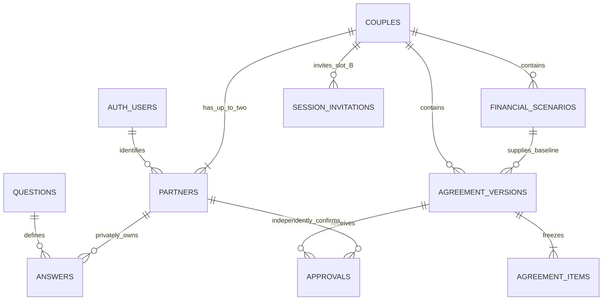

# FirstSharedMoney: Database Schema

Status: logical PostgreSQL design for later Supabase migrations. Nothing in this
document has been applied to a database or verified against a live instance.
The schema, policies, and transaction functions must ship together; table DDL
alone is not a working or secure backend.

Phase 4A prepares the couples/partners/session_invitations slice in four local
migrations. No migration is applied. Other tables remain future work. The head
pointer is restricted to NULL until agreement_versions and its composite FK
are implemented. See [PHASE4A_BACKEND.md](PHASE4A_BACKEND.md).

## 1. Conventions and relationships

- UUID primary keys use database-generated random UUIDs. All timestamps are
  `timestamptz`; server time is authoritative. JSON field names follow TypeScript
  DTO casing; table columns use snake_case and explicit adapters.
- Monetary JSON fields are safe integer cents. Persist individual monetary
  columns, if extracted later, as `bigint` with a check from 0 to
  1,000,000,000,000. Bound computed totals too. No floats for stored amounts.
- Database arithmetic that multiplies two cent amounts uses exact `numeric`
  intermediates to avoid `bigint` overflow. TypeScript uses `bigint` intermediates.
- Use checked `text` values rather than PostgreSQL enums for short MVP domains.
  Required fields are NOT NULL unless explicitly marked nullable below.
- Core application tables are in `public`, with RLS enabled and explicit grants.
  The invitation table is in non-exposed `fsm_private`, with no browser grants.
- Do not store bank/card credentials, bank account identifiers, email addresses,
  legal names, or a copy of Auth credentials in application tables.

Every session-owned child has `couple_id -> couples.id ON DELETE CASCADE`.
Redundant couple IDs are intentional: composite foreign keys prevent attaching
a partner, scenario, item, or approval from a different session.

## 2. Table definitions

### public.couples

| Column | Type | Rules |
| --- | --- | --- |
| id | uuid | PK, default random UUID |
| mode | text | CHECK IN ('standard', 'demo') |
| currency | text | DEFAULT 'USD', CHECK = 'USD' |
| questionnaire_version | smallint | DEFAULT 1, CHECK = 1 for the MVP |
| created_by_auth_user_id | uuid | FK auth.users(id), ON DELETE RESTRICT |
| creation_request_id | uuid | Caller-generated idempotency key |
| creation_request_fingerprint | text | 64 lowercase hex characters |
| current_agreement_version_id | uuid, nullable | Composite FK described below |
| created_at | timestamptz | DEFAULT now() |
| expires_at | timestamptz | CHECK > created_at; server chooses 30 days or two hours |

UNIQUE `(created_by_auth_user_id, creation_request_id)`. The fingerprint includes
the operation (standard/demo) and normalized display name, so retrying the same
key through another creation route is a conflict.

After creating agreement_versions, add a DEFERRABLE INITIALLY DEFERRED FK
`(current_agreement_version_id, id) -> agreement_versions(id, couple_id)` with
NO ACTION on delete. This prevents cross-session head pointers. The creation
transaction must also insert the creator as slot A. A deferred integrity trigger
checks that each surviving couple has exactly one A matching the creator ID.

No saved workflow stage is needed: derive it from membership, questionnaire
status, and sharing flags. Expiration is checked on every operation, not only
when cleanup runs.

### public.partners

| Column | Type | Rules |
| --- | --- | --- |
| id | uuid | PK, default random UUID |
| couple_id | uuid | FK couples, CASCADE |
| auth_user_id | uuid | FK auth.users(id), ON DELETE RESTRICT |
| slot | text | CHECK IN ('A', 'B') |
| display_name | text | Trimmed plain text, char_length 1-40 |
| questionnaire_status | text | DEFAULT 'draft', CHECK IN ('draft', 'submitted') |
| questionnaire_revision | integer | DEFAULT 0, CHECK >= 0; monotonic, reject overflow |
| submitted_at | timestamptz, nullable | Required exactly when status is submitted |
| comparison_consent_at | timestamptz, nullable | Null means withheld |
| budget_consent_at | timestamptz, nullable | Null means withheld |
| joined_at | timestamptz | DEFAULT now() |
| access_expires_at | timestamptz | CHECK > joined_at; no later than couple expiry |
| revoked_at | timestamptz, nullable | CHECK >= joined_at when present |

UNIQUE `(couple_id, slot)`, UNIQUE `(couple_id, auth_user_id)`, and UNIQUE
`(id, couple_id)` for composite references. Because the only legal slots are A
and B, the unique slot constraint enforces a hard maximum of two participants,
including concurrent joins. One Auth identity cannot occupy both slots.

CHECK either draft + null submitted_at + both null consents, or submitted +
non-null submitted_at. A submitted questionnaire can withhold either consent.
Membership identity and slot never change after insertion; a revoked member is
not deleted or replaced. An expiry-validation trigger checks the parent expiry.

Partner SELECT is owner-only. `Partner` in domain.ts is instead a deliberately
limited shared projection generated by `fsm_get_session`; it has no Auth ID or
answer payload. Never serialize an entire partner row as that DTO.

### public.questions

| Column | Type | Rules |
| --- | --- | --- |
| catalog_version | smallint | CHECK = 1 for MVP |
| code | text | Stable code from AnswerValueByQuestion |
| category | text | One of the ten QuestionCategory values |
| kind | text | money / single_choice / multiple_choice / slider / text |
| title | text | English, char_length 1-200 |
| help_text | text | English, char_length <= 500 |
| is_required | boolean | Fourteen true; optional discussion_note is false |
| position | smallint | CHECK BETWEEN 1 AND 15 |
| comparison_rule | text | exact / set_equality / none |
| control | jsonb | Validated Question control: options, bounds, or text length |

Composite PK `(catalog_version, code)`; UNIQUE `(catalog_version, position)`.
`control` must be an object of at most 8 KiB and match kind. Choice values are
unique and use the exact allowed literals in domain.ts. Only migrations/admin
seed scripts may write this immutable published catalog. Do not change v1
questions after answers exist; a future catalog version requires a migration.

See USER_FLOW.md for all 15 question codes and comparison rules. At deployment,
a seed assertion checks the exact code set, 15 positions, and 14 required items.

### public.answers

| Column | Type | Rules |
| --- | --- | --- |
| id | uuid | PK, default random UUID |
| couple_id | uuid | FK couples, CASCADE |
| partner_id | uuid | Composite FK (partner_id, couple_id) -> partners(id, couple_id), CASCADE |
| catalog_version | smallint | Same as session catalog version |
| question_code | text | Composite FK (catalog_version, question_code) -> questions(catalog_version, code), RESTRICT |
| value | jsonb | Tagged AnswerValueByQuestion payload; object, <= 4 KiB |
| created_at | timestamptz | DEFAULT now() |
| updated_at | timestamptz | Server-generated on a successful save |

UNIQUE `(partner_id, catalog_version, question_code)`. A validation trigger loads
the referenced question and parent, verifies catalog/kind/options, rejects unknown
keys, bounds money and sliders, rejects duplicate multiple choices, and limits
text to 500 characters. JSON numeric values must be integral numbers, not numeric
strings, NaN, or fractions. This cross-row validation belongs in a trigger or
transaction function, not a CHECK that queries another table.

Only the save-answer RPC changes rows, and only while the owner's questionnaire
is draft. It locks the parent first, checks expectedRevision, and increments the
partner revision once. Submission validates the complete answer set. Reopening
keeps answers as the owner's draft and clears consent and submitted_at. Shared
historical agreements are not rewritten by questionnaire changes.

### public.financial_scenarios

| Column | Type | Rules |
| --- | --- | --- |
| id | uuid | PK, default random UUID |
| couple_id | uuid | FK couples, CASCADE |
| created_by_partner_id | uuid | Composite FK to partners(id, couple_id), CASCADE |
| client_request_id | uuid | Idempotency key |
| request_fingerprint | text | 64 lowercase hex characters |
| source_revision_a | integer | CHECK >= 0 |
| source_revision_b | integer | CHECK >= 0 |
| engine_version | text | CHECK = 'fsm-finance-v1' for MVP |
| input_snapshot | jsonb | Validated FinancialInput; baseline oneOffSharedExpenseCents = 0 |
| split_model | jsonb | Validated SplitModel |
| stress_test | jsonb, nullable | Null for baseline; otherwise validated StressTestScenario |
| output_snapshot | jsonb | Validated SimulationOutput, including an unavailable result |
| created_at | timestamptz | DEFAULT now() |

UNIQUE `(id, couple_id)` and UNIQUE
`(couple_id, created_by_partner_id, client_request_id)`. Input/output snapshots
are objects, capped at 16/32 KiB. JSON revisions must equal the typed columns.
Income and obligation inputs must equal the currently consented answers read
by the server. The RPC rechecks this at commit, not just before computation.

Scenarios are immutable. Only a server-role command can store a recomputed
output. There is no authenticated table write or public RPC accepting calculated
contributions. The creator cannot overwrite the other partner's income. The
read policy requires both current budget consents and matching submitted revisions;
old sensitive snapshots do not become visible under unrelated later consents.

### public.agreement_versions

| Column | Type | Rules |
| --- | --- | --- |
| id | uuid | PK, default random UUID |
| couple_id | uuid | FK couples, CASCADE |
| version_number | integer | CHECK >= 1, assigned under couple lock |
| parent_version_id | uuid, nullable | Composite FK (parent_version_id, couple_id) -> same table (id, couple_id) |
| created_by_partner_id | uuid | Composite FK to partners(id, couple_id), CASCADE |
| client_request_id | uuid | Idempotency key |
| request_fingerprint | text | 64 lowercase hex characters |
| source_scenario_id | uuid | Composite FK (source_scenario_id, couple_id) -> financial_scenarios(id, couple_id) |
| source_revision_a | integer | CHECK >= 0, must match source scenario |
| source_revision_b | integer | CHECK >= 0, must match source scenario |
| schema_version | smallint | DEFAULT 1, CHECK = 1 |
| financial_summary | jsonb | AgreementFinancialSummary; <= 8 KiB; no raw incomes/obligations |
| content_hash | text | 64 lowercase hex characters; computed by server |
| status | text | draft / proposed / under_review / approved |
| created_at | timestamptz | DEFAULT now() |
| proposed_at | timestamptz, nullable | Null for draft; required for subsequent states |
| approved_at | timestamptz, nullable | Present exactly for approved |

UNIQUE `(id, couple_id)`, UNIQUE `(id, couple_id, content_hash)`, UNIQUE
`(couple_id, version_number)`, and UNIQUE
`(couple_id, created_by_partner_id, client_request_id)`.

Parent and scenario composite FKs use DEFERRABLE INITIALLY DEFERRED NO ACTION
on delete. Whole-session cascading deletion removes the complete dependency
set; individual version/scenario deletion is not an application operation.
Parent numbers must be lower and a new version's parent must be the previous
current head. Content columns are immutable, including on draft rows. A trigger
allows only valid lifecycle timestamp/status changes after insertion.

`financial_summary` and monetary item values are derived from a server-stored,
available baseline scenario. They never contain the original private income,
obligation, or note fields. Creating a new version starts draft with zero
approvals. Old approved versions remain inspectable as historical shared terms.

### public.agreement_items

| Column | Type | Rules |
| --- | --- | --- |
| id | uuid | PK, default random UUID |
| couple_id | uuid | FK couples, CASCADE |
| version_id | uuid | Composite FK (version_id, couple_id) -> agreement_versions(id, couple_id), CASCADE |
| item_key | text | One of the nine keys below |
| position | smallint | CHECK BETWEEN 0 AND 8; fixed mapping to key |
| value | jsonb | Validated variant payload; <= 4 KiB; no arbitrary text/HTML |

UNIQUE `(version_id, item_key)` and UNIQUE `(version_id, position)`. Exactly nine
items are inserted with each version, including explicit zero-valued expense
categories. They cannot be edited in place.

| Position/key | JSON value shape and required validation |
| --- | --- |
| 0 rent | `{ monthlyCents }`, bounded cents from source scenario |
| 1 utilities | `{ monthlyCents }`, bounded cents from source scenario |
| 2 groceries | `{ monthlyCents }`, bounded cents from source scenario |
| 3 other | `{ monthlyCents }`, bounded cents from source scenario |
| 4 shared_savings | `{ monthlyCents }`, bounded cents from source scenario |
| 5 personal_spending | `{ rule, debtExpectation }`, exact domain literals |
| 6 large_purchase | `{ thresholdCents }`, bounded cents |
| 7 emergency | `{ rule }`, EmergencyRule literal |
| 8 review | `{ frequency, nextReviewDate }`, ReviewFrequency and a real ISO calendar date |

The financial summary's model applies to the combined household monthly total.
The document lists category amounts and total A/B contributions; individual
category contribution rounding is not introduced in the MVP.

### public.approvals

| Column | Type | Rules |
| --- | --- | --- |
| id | uuid | PK, default random UUID |
| couple_id | uuid | FK couples, CASCADE |
| version_id | uuid | Part of composite FK to agreement_versions |
| partner_id | uuid | Composite FK (partner_id, couple_id) -> partners(id, couple_id), CASCADE |
| content_hash | text | Composite FK (version_id, couple_id, content_hash) -> agreement_versions(id, couple_id, content_hash), CASCADE |
| approved_at | timestamptz | DEFAULT now(), never supplied by the client |

UNIQUE `(version_id, partner_id)`. Partner slot is joined from the immutable
partner row when constructing the Approval DTO; it is not a client-supplied
approval column. An insert trigger/approval RPC checks membership, head, content,
consent, submitted revisions, and workflow state while holding the couple lock.
Approvals are append-only; no application UPDATE or individual DELETE.

A deferred constraint trigger checks, at transaction end, that draft/proposed
versions have zero approvals, under_review has exactly one, and approved has
exactly two distinct same-couple partners with the version's hash. Thus an Edge
bug cannot mark a row approved merely by setting its status. Historical rows
retain their old confirmations when a new head is created.

### fsm_private.session_invitations

This ninth supporting table is necessary for invitation expiry, single use, and
revocation. Do not mix invitation capabilities into shared partner/couple rows.

| Column | Type | Rules |
| --- | --- | --- |
| id | uuid | PK, default random UUID |
| couple_id | uuid | FK couples, CASCADE |
| created_by_partner_id | uuid | Composite FK to partners(id, couple_id), CASCADE; must be A |
| target_slot | text | DEFAULT 'B', CHECK = 'B' |
| token_hash | text | UNIQUE, 64 lowercase hex characters; never return |
| created_at | timestamptz | DEFAULT now() |
| expires_at | timestamptz | CHECK > created_at, no later than couple expiry or 24 hours |
| consumed_at | timestamptz, nullable | CHECK >= created_at |
| consumed_by_partner_id | uuid, nullable | Composite FK to partners(id, couple_id), CASCADE |
| revoked_at | timestamptz, nullable | CHECK >= created_at |

CHECK consumed_at and consumed_by_partner_id are both null or both non-null.
A consumed row cannot also be revoked. A partial unique index on couple_id WHERE
consumed_at IS NULL AND revoked_at IS NULL permits only one outstanding invite.
Do not use `now()` in an index predicate: expired unconsumed invitations are
explicitly revoked before rotation. A trigger validates A/B roles and expiry.

The issuance function generates 32 random bytes, returns base64url raw material
once, and stores its SHA-256 digest. Never accept a client-selected digest/token
at issuance. Raw tokens cannot be recovered, including on an idempotent creation
retry. Generate a new invitation if its initial response is lost.

## 3. Index plan

Primary/unique constraints already create their indexes; do not duplicate them.
Add the following non-unique indexes for lookup, FK checks, cleanup, and quotas:

| Table | Index columns / predicate | Purpose |
| --- | --- | --- |
| couples | (expires_at) | Expiry cleanup |
| couples | (created_by_auth_user_id, created_at DESC) | Creation quota |
| partners | (auth_user_id, couple_id) WHERE revoked_at IS NULL | Identity membership lookup |
| answers | (couple_id) | Session deletion / scope lookup |
| financial_scenarios | (couple_id, created_at DESC) | Session access and write quota |
| financial_scenarios | (created_by_partner_id, couple_id) | Partner FK |
| agreement_versions | (couple_id, created_at DESC) | Version quota |
| agreement_versions | (source_scenario_id, couple_id) | Scenario FK |
| agreement_versions | (created_by_partner_id, couple_id) | Partner FK |
| agreement_versions | (parent_version_id, couple_id) WHERE parent_version_id IS NOT NULL | Parent-version FK |
| agreement_items | (couple_id) | Session deletion |
| approvals | (couple_id) | Session scope and deletion |
| approvals | (partner_id, couple_id) | Partner FK |
| session_invitations | (couple_id, created_at DESC) | All invitation history and deletion |
| session_invitations | (created_by_partner_id, couple_id) | Issuer FK |
| session_invitations | (consumed_by_partner_id, couple_id) WHERE consumed_by_partner_id IS NOT NULL | Consumer FK |

Existing unique indexes cover answer lookup by partner/catalog/code, item and
approval lookup by version, token redemption by digest, and version history by
couple/version number. No GIN/JSON or text-search index is needed.

## 4. Permissions and RLS matrix

Revoke table/sequence rights from `anon` and direct write rights from
`authenticated`. Grant only the SELECT operations below. Enable RLS explicitly
on every table, including invitation storage. No permissive catch-all policies.

Define narrow non-exposed helper functions `is_active_member(couple_id)`,
`owns_partner(partner_id, couple_id)`, and
`budget_snapshot_is_current(couple_id, revision_a, revision_b)`. They use
`auth.uid()` internally, check expiry/revocation, and return boolean only.
They must avoid recursive policy evaluation when querying partners/couples:
use carefully owned definer helpers with empty search_path and explicit grants.
Grant only schema USAGE/helper EXECUTE as needed, never private-table SELECT.

| Table | Browser SELECT policy | Browser direct writes |
| --- | --- | --- |
| couples | Caller is an active member | None |
| partners | auth_user_id = auth.uid() AND active membership | None |
| questions | Authenticated user; non-sensitive immutable catalog only | None |
| answers | owns_partner(partner_id, couple_id) | None |
| financial_scenarios | Active member AND both current budget consents AND matching submitted source revisions | None |
| agreement_versions | Active member; explicitly shared terms only | None |
| agreement_items | Active member of same couple | None |
| approvals | Active member of same couple | None |
| session_invitations | No grant and no allow policy | None |

User command RPCs authenticate with auth.uid(), and validate all their rules
internally even though definer functions can bypass RLS. Revoke default EXECUTE
from PUBLIC/anon and explicit grants from unwanted roles for every function;
grant only the exact intended audience. Also set safe default privileges for
future functions. Expose public FSM RPCs only, not helper schemas.

The server-only comparison/input/store RPCs described in ARCHITECTURE.md are
executable by the server role only. Their actor argument comes from verified
Edge identity, never request JSON. Elevated credentials must never reach the
browser. Client direct RPC calls are part of the security test surface.

## 5. Required transaction algorithms

All session mutations lock `couples WHERE id = ... FOR UPDATE` first, then
child rows in consistent order (partners by slot, invitation/version, child
rows). No state-changing command takes those locks in the reverse order.
Recheck expiry with the actual database clock after acquiring locks; a
transaction's cached start timestamp must not authorize a token that expired
while the command was waiting.
See [PostgreSQL row locking](https://www.postgresql.org/docs/current/explicit-locking.html).

### Session creation and invitation redemption

Creation locks the caller's per-user quota key, checks idempotency/quota, inserts
the couple and A, and mints the B invitation in one transaction. A retry of an
identical creation request returns its existing session without a raw token.

Redemption first finds a candidate couple ID by token digest without taking a
child lock, then locks that couple, then re-reads/locks the invitation and
revalidates digest, expiry, consumed/revoked state, active A, and vacant B.
Insert B and mark consumed in that transaction. A competing redemption must not
insert a third seat or expose another caller's membership. Same-user retries
may return the already-created B while the invitation is still unexpired and
that membership is active. Other callers receive INVALID_INVITATION.

### Questionnaire and consent commands

Lock parent, derive own partner from auth.uid(), verify expected revision and
status, validate payload, then mutate answers/metadata and increment the partner
revision. No request can address another partner's answers. Reopening removes
submission and both consents. Consent changes also increment revision, so older
numeric snapshots cannot accidentally become current again.

### Server scenario persistence

Edge obtains a verified actor and a consented input snapshot from an internal
read RPC, runs the portable financial engine, and calls the server-only store
RPC. The store transaction locks parent, rechecks identity/consents/revisions,
compares snapshot inputs to current submitted values, validates shapes/quotas,
and inserts the immutable result. If data changed during computation, return
INPUTS_CHANGED; do not store or approve the stale calculation.

### New version, proposal, and approval

1. New-version RPC locks parent, handles idempotency, verifies expected head,
   checks both active submissions/consents and a current available baseline
   scenario, and validates rules/date. It creates the next version and all nine
   items, derives monetary summary, computes hash, and moves the head. It copies
   no approvals. Existing version contents are never modified.
2. Proposal locks parent/current version, checks expected head/hash, scenario
   freshness and complete items, then changes draft to proposed.
3. Approval locks parent/current version and both partner rows. Derive caller's
   partner, verify head/hash/readiness, and insert only that actor's approval.
   Recompute lifecycle state from distinct version-bound approval rows. An
   identical existing approval is returned idempotently, including after the
   second approval has made the current version approved.
4. A version edit racing an approval serializes on the same parent. An approval
   of the old head after the edit returns STALE_VERSION and cannot affect the
   new version. Deletion and consent withdrawal serialize against these writes.

Approval and transaction-state checks must be in SQL/RPC, not a sequence of
independent REST calls from Edge. A client cannot supply an actor ID, status,
count, authoritative hash, or approval timestamp to bypass this boundary.

### Revocation, deletion, and cleanup

Self-revocation marks only the caller's partner row revoked. If it is A before
B joins, also revoke outstanding invitations. No seat replacement/recovery is
offered. The remaining member may read historical shared terms or delete the
session, but cannot obtain a second approval on behalf of the departed partner.

Whole-session deletion checks the active actor and confirmation, locks parent,
clears its head pointer, and hard-deletes the couple. Child cascades remove
answers, scenarios, versions, items, approvals, partners, and invitations. Do not
delete shared question catalog rows. Auth cleanup runs only after memberships
and creator references have been removed; never delete an Auth user referenced
by another session. The expiry cleanup follows the same cascade path.

## 6. Database verification required before real-data use

No database tests have been run in Phase 2. Future migrations must be checked
in an isolated Supabase test environment with at least A, B, and outsider C:

- Anonymous/no-JWT requests and outsider JWTs cannot read session data.
- A cannot SELECT B's answers or use public RPC parameters to write as B.
- Withheld/withdrawn sharing flags block comparison and numeric snapshots,
  including direct Data API/RPC calls and old scenario IDs.
- Private invitation hashes and server-only RPC inputs are inaccessible.
- Two concurrent redemptions create exactly one B; a third seat is impossible.
- Expired/revoked tokens and memberships fail while ordinary JWTs still exist.
- Concurrent edits/approvals cannot count confirmations across versions;
  forged status/hash/partner values and missing-item versions fail.
- Expected-revision conflicts preserve both users' data. Idempotency keys do
  not replay a different payload or bypass current authorization.
- Cascading deletion removes every session-owned row, and no public recovery
  link or cached API response restores it.

Authoritative references: [Supabase RLS](https://supabase.com/docs/guides/database/postgres/row-level-security)
and [function privileges](https://supabase.com/docs/guides/database/functions).
